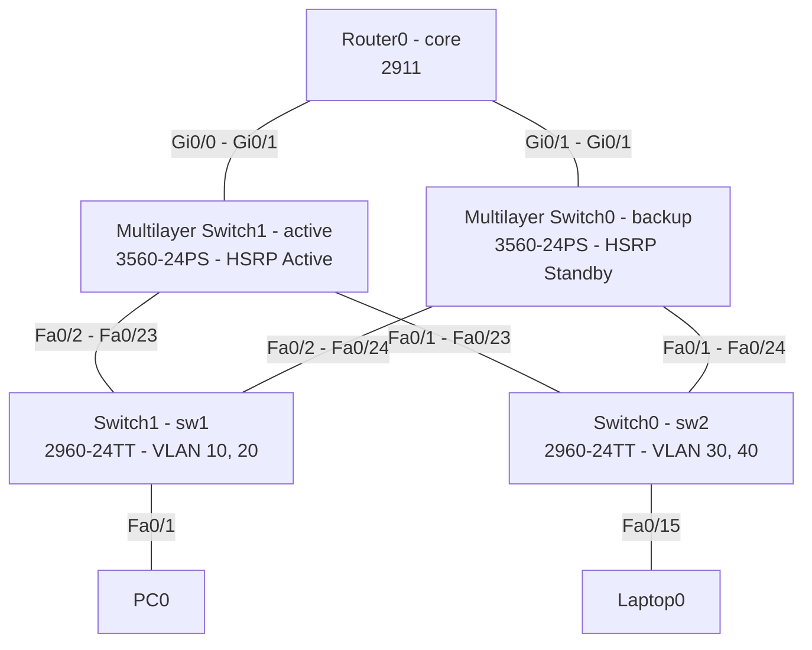

# Redundant Campus Network with HSRP (Cisco Packet Tracer)

A Cisco Packet Tracer lab that models a small enterprise campus network for the `itgate.com` domain. It uses a **dual-homed access layer**, a pair of **Layer 3 multilayer switches running HSRP** for gateway redundancy, **DHCP per VLAN**, **Rapid-PVST+** for loop prevention, and **SSHv2** for device management.

> Built with Cisco Packet Tracer **8.2.2**. Open `pro1.pkt` to explore the topology and device configs.

---

## Table of Contents

- [Topology](#topology)
- [Devices](#devices)
- [VLAN & IP Plan](#vlan--ip-plan)
- [Physical Connections](#physical-connections)
- [Key Features & Configuration](#key-features--configuration)
- [How to Run](#how-to-run)
- [Verification Commands](#verification-commands)
- [Known Issues & Possible Improvements](#known-issues--possible-improvements)
- [Repository Structure](#repository-structure)
- [Security Note](#security-note)

---

## Topology



<!-- Optional: add a screenshot of the Packet Tracer workspace

-->

---

## Devices

| Device (PT name)      | Hostname | Model                    | Role                                    |
|-----------------------|----------|--------------------------|-----------------------------------------|
| Router0               | `core`   | Cisco 2911               | Core router                             |
| Multilayer Switch1    | `active` | Cisco 3560-24PS          | Distribution / L3 gateway (HSRP Active) |
| Multilayer Switch0    | `backup` | Cisco 3560-24PS          | Distribution / L3 gateway (HSRP Standby)|
| Switch1               | `sw1`    | Cisco 2960-24TT          | Access switch (VLAN 10 & 20)            |
| Switch0               | `sw2`    | Cisco 2960-24TT          | Access switch (VLAN 30 & 40)            |
| PC0                   | –        | PC-PT                    | End host (HR VLAN)                      |
| Laptop0               | –        | Laptop-PT                | End host (Mobile App VLAN)              |

---

## VLAN & IP Plan

| VLAN | Name         | Subnet             | Real SVI IPs (active / backup)   | HSRP Virtual Gateway |
|------|--------------|--------------------|----------------------------------|----------------------|
| 10   | `hr`         | 192.168.10.0/24    | 192.168.10.1 (both)              | 192.168.10.100       |
| 20   | `marketing`  | 192.168.20.0/24    | 192.168.20.1 (both)              | 192.168.20.100       |
| 30   | `it`         | 192.168.30.0/24    | 192.168.30.1 (both)              | 192.168.30.100       |
| 40   | `mobile_app` | 192.168.40.0/24    | 192.168.40.1 (both)              | 192.168.40.100       |

- DNS handed out by DHCP: `8.8.8.8`
- Access switch **sw1** (`Switch1`) carries VLANs **10, 20**.
- Access switch **sw2** (`Switch0`) carries VLANs **30, 40**.
- Ports `Fa0/1–10` → first VLAN of the switch, `Fa0/11–20` → second VLAN.

---

## Physical Connections

| From                      | Port      | To                         | Port      | Cable          |
|---------------------------|-----------|----------------------------|-----------|----------------|
| Router0 (core)            | Gi0/0     | Multilayer Switch1 (active)| Gi0/1     | Straight-through |
| Router0 (core)            | Gi0/1     | Multilayer Switch0 (backup)| Gi0/1     | Straight-through |
| Multilayer Switch1 (active)| Fa0/2    | Switch1 (sw1)              | Fa0/23    | Crossover      |
| Multilayer Switch0 (backup)| Fa0/2    | Switch1 (sw1)              | Fa0/24    | Crossover      |
| Multilayer Switch1 (active)| Fa0/1    | Switch0 (sw2)              | Fa0/23    | Crossover      |
| Multilayer Switch0 (backup)| Fa0/1    | Switch0 (sw2)              | Fa0/24    | Crossover      |
| Switch1 (sw1)             | Fa0/1     | PC0                        | Fa0       | Straight-through |
| Switch0 (sw2)             | Fa0/15    | Laptop0                    | Fa0       | Straight-through |

Each access switch is connected to **both** distribution switches, so the loss of any single uplink or distribution switch does not isolate a VLAN.

---

## Key Features & Configuration

### 1. Gateway redundancy – HSRP
- HSRP group `1` on every SVI (VLAN 10/20/30/40).
- `active` has **priority 255** with **preempt**; `backup` uses the default priority (100) with **preempt**.
- Hosts use the virtual IPs (`.100`) as their default gateway.

### 2. Inter-VLAN routing
- `ip routing` is enabled on both multilayer switches; each VLAN has an SVI (`.1`).

### 3. DHCP
- One DHCP pool per VLAN (`vlan10` … `vlan40`) on both multilayer switches.
- Each pool provides the HSRP virtual IP as default router and `8.8.8.8` as DNS server.

### 4. Spanning Tree
- Access switches run **Rapid-PVST+** and are set to the *lowest priority* (`61440`) for their VLANs, so they never become root.
- Root bridge placement:
  - `active` → priority **24576** (primary root) for VLANs 10, 20, 30, 40
  - `backup` → priority **28672** (secondary root) for VLANs 10, 20, 30, 40
- **PortFast + BPDU Guard** on all end-user ports.

### 5. Trunking
- Switch-to-switch links use **802.1Q** trunks.
- Access switches restrict trunks to their own VLANs (`switchport trunk allowed vlan`).

### 6. Secure management
- `ip domain-name itgate.com`, **SSH version 2**, `transport input ssh` on VTY lines.
- Local user authentication (`login local`) on console and VTY.
- `enable secret` set on all devices and `service password-encryption` enabled.

---

## How to Run

1. Install [Cisco Packet Tracer](https://www.netacad.com/courses/packet-tracer) (**8.2.2 or newer** recommended).
2. Clone this repository:
   ```bash
   git clone https://github.com/<your-username>/<your-repo>.git
   ```
3. Open `pro1.pkt` in Packet Tracer (`File → Open`).
4. Wait for the link lights to turn green (STP convergence takes a few seconds).
5. Click on any device → **CLI** tab to inspect or modify the configuration.

---

## Verification Commands

On the multilayer switches (`active` / `backup`):

```
show standby brief          ! HSRP state per VLAN
show ip interface brief     ! SVI status and IPs
show spanning-tree summary  ! STP mode and root info
show ip dhcp binding        ! Leases handed out
show interfaces trunk       ! Trunk links and allowed VLANs
```

On the access switches (`sw1` / `sw2`):

```
show vlan brief
show interfaces trunk
show spanning-tree
```

On the end devices:

```
ipconfig /all
ping 192.168.10.100     ! Reach the virtual gateway
```

**Failover test:** shut down the uplinks of `active` (or power it off) and confirm that `backup` becomes HSRP *Active* and hosts keep their connectivity; bring `active` back and confirm it preempts.

---

## Known Issues & Possible Improvements

Based on the saved state of the `.pkt` file, these are good next steps for the lab:

- **Router (`core`) is not configured yet** – the sub-interfaces `Gi0/0.1–.4` exist but have no encapsulation/IP, and `Gi0/0`/`Gi0/1` have no IP addresses. Add routing/NAT toward an upstream network if you want external connectivity.
- **STP mode mismatch** – `active` runs `rapid-pvst` while `backup` runs `pvst`. Use `rapid-pvst` on both.
- **sw2 uplinks** – `Fa0/23–24` have no explicit trunk configuration in the saved config; set them as 802.1Q trunks allowing VLANs 30, 40.
- **sw2 host ports** – access ports are configured with `switchport mode trunk` together with `switchport access vlan …`. For end-user ports use `switchport mode access`. This is likely why `Laptop0` currently shows an APIPA address (`169.254.x.x`) instead of a DHCP lease.
- **DHCP pools** – both multilayer switches serve identical pools with no excluded addresses. Exclude `.1`, `.2`, and `.100` in each subnet, and consider splitting the ranges (or serving DHCP from only one device) to avoid duplicate leases/conflicts.
- **HSRP** – consider tracking the uplink to the router (`standby track`) and using distinct HSRP group numbers per VLAN, with load-balancing (active for VLANs 10/20 on one switch and 30/40 on the other).
- **Management IPs on access switches** – `sw1` has a `Vlan10` SVI without an IP address, and `sw2` has none. Assign a management IP (and default gateway) on each access switch to actually reach them over SSH.

---

## Repository Structure

```
.
├── pro1.pkt        # Cisco Packet Tracer project file
├── README.md       # This file
└── docs/           # (optional) screenshots / diagrams
```

---

## Security Note

This is a **lab** environment. Before reusing any configuration in production:

- Replace the lab credentials and `enable secret` with strong, unique values.
- Prefer `username … secret` (type 5/8/9) over `password 7`, which is reversible.
- Do not commit real passwords, hashes, or production IP addressing to a public repository.

---

## License

Released for educational purposes. Add a license of your choice (e.g. MIT) in a `LICENSE` file.
